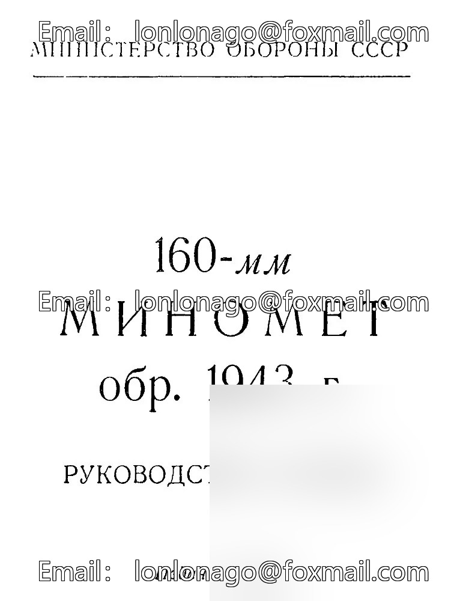
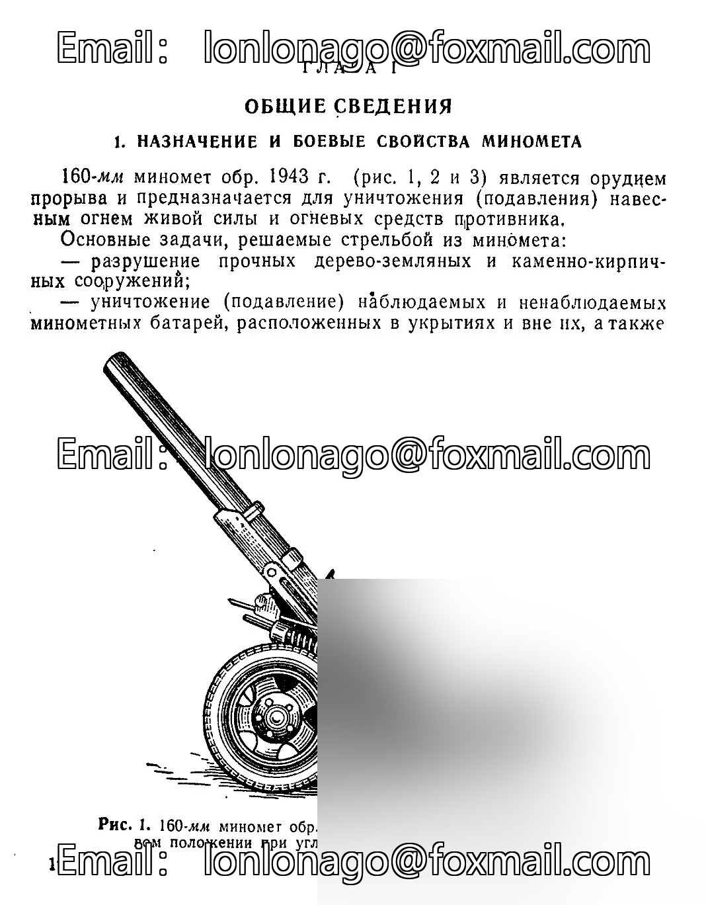
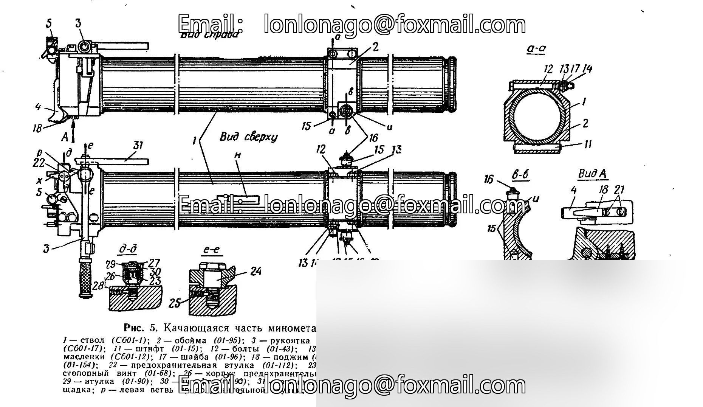
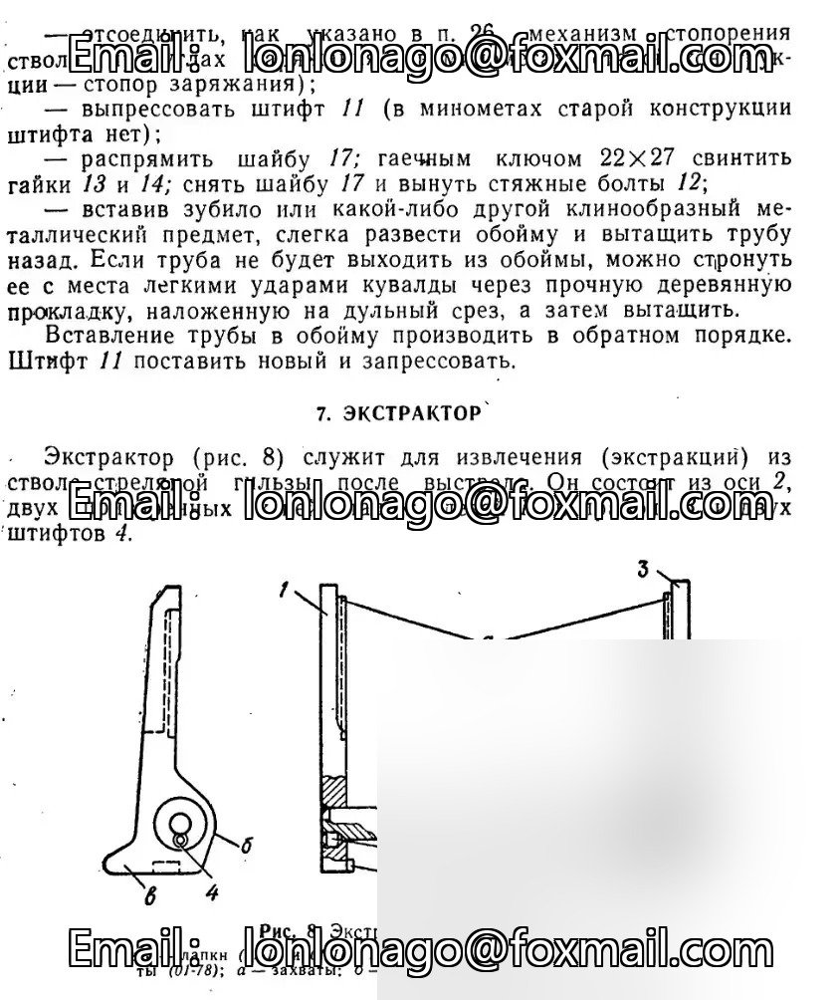
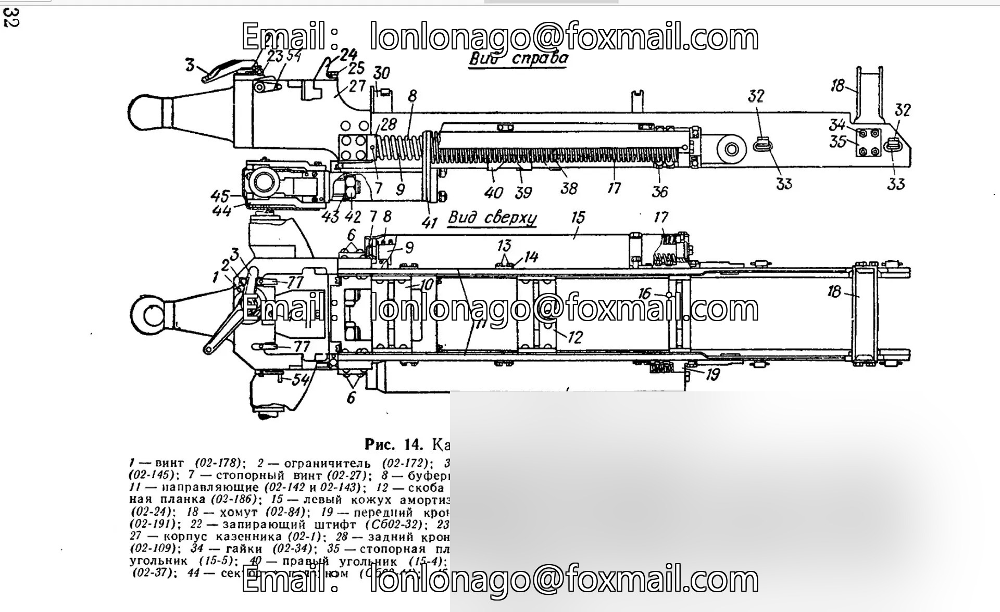

# Soviet 1943 160-millimeter howitzer (160-mm mortar)

## Body

The manual for the 160-millimeter machine gun (160-mm machine gun, Original 1943 g.) of the Soviet Union, second edition.
Published by the Soviet Ministry of Defense, it provides detailed introduction of the technical parameters, operation procedures, and maintenance and preservation methods of this type of machine gun.
Includes the following content:
1. Cannon body structure and operating principle
2. Shooting calculation and aiming method
3. Daily maintenance and fault removal
4. Tactical application and training key points
5. Combat support and logistics support

The materials cover the 1943 Soviet 160-mm artillery gun technical parameters, operating procedures, maintenance and troubleshooting methods, tactical application and training points.

<!-- AI_ENRICHED -->

## Images

## Payment

Here is a pay link on Stripe ( https://buy.stripe.com/3cs8yP7sY87d0vu9AB ). Please contact me lonlonago@foxmail.com after funding $89, and I will send you a complete data files , thank you!

